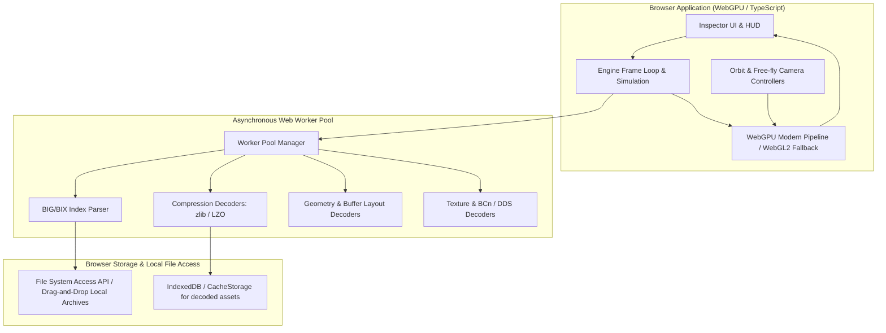

# Sleeping Dogs Browser Reconstruction — Architecture Specification

## 1. High-Level System Architecture

---

## 2. Component Design Principles

### A. Immutability of Game Data
The user's original game files (`.big`, `.bix`, `.pck`) are treated strictly as **read-only source archives**. All decoding operates in-memory or persists into local browser storage caches.

### B. Decoupled Parsing and Rendering
- The archive and resource decoding layer is written as pure, headless TypeScript modules.
- The rendering layer consumes standardized browser structures (`GPUVertexBufferLayout`, `GPUTexture`, etc.) without knowing archive details.

### C. Zero Main-Thread Blocking
All archive parsing, decompilation, decompression, and geometry unpacking run in dedicated Web Workers. Only finalized typed arrays (Float32Array, Uint16Array) are transferred to the main thread via zero-copy `ArrayBuffer` transfers.

---

## 3. Technology Stack

- **Language:** TypeScript
- **Bundler / Dev Server:** Vite
- **Graphics Backend:** WebGPU (`navigator.gpu`) with clean WebGL2 fallback
- **Math & Scene Graph:** Modular lightweight linear algebra (`gl-matrix` or custom SIMD-ready primitives)
- **Archive IO:** Web Streams API / `Blob.slice()` for chunked, random-access streaming without loading multi-gigabyte `.big` files into RAM.

