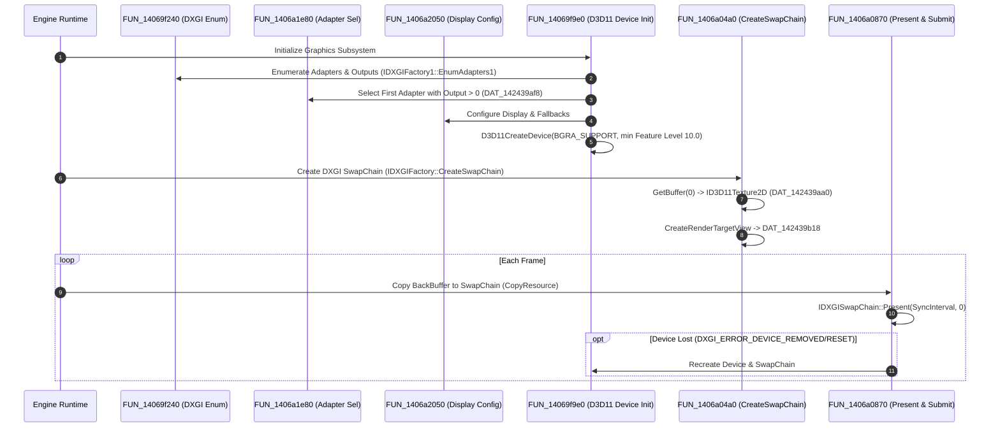

# Sleeping Dogs: Definitive Edition — Graphics Architecture & Reverse-Engineering Report

**Verified Date:** 31 October 2026  
**Status:** CONFIRMED via Ghidra 12.2 Headless Decompilation (`sdhdship.exe`)

---

## 1. Complete Direct3D 11 & DXGI Lifecycle

The complete graphics initialization, swap chain configuration, frame presentation, and device lost recovery paths have been mapped:

---

## 2. Core Graphics Functions Ledger

| Function | Entry Address | Role / Identified COM API Calls | Confidence |
|---|---|---|---|
| `CreateDXGIFactory1` | `0x1406a0dd0` | Calls `CreateDXGIFactory1` and stores factory in `DAT_142439af0`. | `CONFIRMED` |
| `DXGI Enum` | `0x14069f240` | Uses `IDXGIFactory1::EnumAdapters1` (vtable `+0x60`), `IDXGIAdapter::EnumOutputs` (`+0x38`), queries `DXGI_FORMAT_R8G8B8A8_UNORM` display modes (`+0x40`). | `CONFIRMED` |
| `Adapter Selection` | `0x1406a1e80` | Iterates adapter list; selects first adapter with outputs (`+0x148 > 0`) into `DAT_142439af8`. | `CONFIRMED` |
| `Display Settings` | `0x1406a2050` | Queries desktop coordinates, calculates aspect ratio, iterates fallback configurations via `FUN_14069ed80`. | `CONFIRMED` |
| `D3D11 Device Init` | `0x14069f9e0` | Calls `D3D11CreateDevice` with selected adapter `DAT_142439af8`, BGRA support (`0x20`), minimum feature level `0xA000` (10.0). Stores device in `DAT_142439ae0` and immediate context in `DAT_142439ae8`. | `CONFIRMED` |
| `Create SwapChain` | `0x1406a04a0` | Populates `DXGI_SWAP_CHAIN_DESC` and calls `IDXGIFactory::CreateSwapChain` (vtable `+0x50`). Stores swap chain in `DAT_142439b10`. Calls `IDXGISwapChain::GetBuffer` (`+0x48`) into `DAT_142439aa0`, then `ID3D11Device::CreateRenderTargetView` (`+0x48`) into `DAT_142439b18`. | `CONFIRMED` |
| `Resize Buffers` | `0x1406a14e0` | Handles window resize: calls `IDXGISwapChain::ResizeBuffers` (vtable `+0x68`, count 2, `DXGI_FORMAT_R8G8B8A8_UNORM`), recreates backbuffer view and stereo render buffers. | `CONFIRMED` |
| `Present & Frame Submit` | `0x1406a0870` | Copies render buffer via `ID3D11DeviceContext::CopyResource` (`+0x178`) to backbuffer `DAT_142439aa0`, executes `IDXGISwapChain::Present` (`+0x40`), tests for `DXGI_ERROR_DEVICE_REMOVED` (`0x887A0005`) / `DXGI_ERROR_DEVICE_RESET` (`0x887A0007`), triggers automatic device recovery if lost. | `CONFIRMED` |

---

## 3. Global Variables Ledger

| Address | Inferred Type | Role |
|---|---|---|
| `0x142439af0` | `IDXGIFactory1*` | Main DXGI factory pointer |
| `0x142439af8` | `IDXGIAdapter1*` | Selected hardware adapter |
| `0x142439b00` | `IDXGIOutput*` | Selected display monitor / output |
| `0x142439ae0` | `ID3D11Device*` | Direct3D 11 device |
| `0x142439ae8` | `ID3D11DeviceContext*` | Direct3D 11 immediate context |
| `0x142439b10` | `IDXGISwapChain*` | Main display swap chain |
| `0x142439aa0` | `ID3D11Texture2D*` | Swap chain backbuffer texture |
| `0x142439b18` | `ID3D11RenderTargetView*` | Main backbuffer render target view |
| `0x14249cdf0` | `HWND` | Win32 application window handle |
| `0x142439a94` | `uint32_t` | Backbuffer width (pixels) |
| `0x142439a98` | `uint32_t` | Backbuffer height (pixels) |
| `0x142439a93` | `uint8_t` | Display configuration dirty / update flag |
| `0x14243a370` | `CRITICAL_SECTION` | Thread lock guarding display and swap chain state |

---

## 4. WebGPU Translation Mapping

| Original Direct3D 11 Concept | WebGPU Browser Equivalent |
|---|---|
| `IDXGIFactory1::EnumAdapters1` | `navigator.gpu.requestAdapter({ powerPreference: "high-performance" })` |
| `D3D11CreateDevice` | `adapter.requestDevice()` |
| `IDXGIFactory::CreateSwapChain` | `context = canvas.getContext("webgpu"); context.configure({ device, format: navigator.gpu.getPreferredCanvasFormat() })` |
| `IDXGISwapChain::GetBuffer` & `RTV` | `context.getCurrentTexture().createView()` |
| `ID3D11DeviceContext::CopyResource` | Direct render-pass attachment write (`colorAttachments[0].view = currentTextureView`) |
| `IDXGISwapChain::Present` | Implicit presentation upon completion of `device.queue.submit([commandEncoder.finish()])` at end of frame |
| `ResizeBuffers` | Resize event listener calling `context.configure()` with updated `canvas.width` and `canvas.height` |
