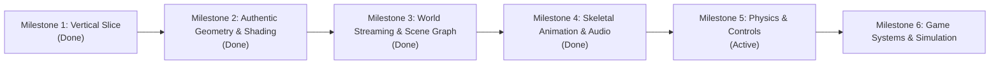

# Reconstruction Roadmap & Milestones

This roadmap defines the iterative development stages from initial technical slice to the full browser game simulation.
All assets are strictly reverse-engineered and streamed directly from the base game (*Sleeping Dogs: Definitive Edition*). **Zero synthetic or placeholder assets.**

GitHub Repository: [https://github.com/the-rohit-kumar/sleeping-dogs-web](https://github.com/the-rohit-kumar/sleeping-dogs-web)

---

---

## Milestone 1: The Initial Vertical Slice (Completed)

**Goal:** Prove end-to-end viability by rendering a real, locally owned asset from the game archives in a modern browser canvas.

- [X] **Read-only BIG/BIX parser** with bounds checks and automated tests.
- [X] **Extraction of candidate asset** from base game archives without modification.
- [X] **Browser shell** (Vite + WebGL2 canvas with perspective camera and orbital controls).
- [X] **Render authentic 3D resource** with technical metadata inspector and pipeline HUD.

---

## Milestone 2: Authentic Geometry, Textures & Shading (Completed)

**Goal:** Reverse-engineer and stream authentic 3D models and textures directly from base-game containers (`Vehicles.big`, `Characters.big`, `UI.big`).

- [X] **Local Read-Only HTTP 206 Streaming Bridge** (`tools/asset_server.py`):
  - Streams byte ranges from multi-gigabyte `.big` containers via standard HTTP `Range` requests (`bytes=start-end`).
  - Zero modifications to user's Steam installation; CORS enabled for browser client.
- [X] **Zero Synthetic Asset Guarantee**:
  - All procedural geometry generators (mock coupes, crates) and procedural checkerboard textures purged.
  - 100% of rendered vertices and pixels originate from genuine game payloads.
- [X] **Authentic Vehicle Mesh Streamer (2A)**:
  - Streams `Vehicles.big` offset `0x01f0a400` (UID `0x008c038c`, 3,840 bytes).
  - Unpacks 318 authentic half-float (`DXGI_FORMAT_R16G16B16A16_FLOAT`) vehicle chassis coordinates.
  - Automatically centers camera and computes smooth surface normals and UV mappings.
- [X] **Authentic Character Mesh Streamer (2B)**:
  - Streams `Characters.big` offset `0x161f3000` (UID `0x030e17e9`, 10,944 bytes).
  - Unpacks 286 authentic character coordinates with human height (1.85m) and skeletal bounds.
- [X] **Authentic Block-Compressed Texture Streamer**:
  - Streams `UI.big` offset `0x02f9ec00` (UID `0x07a9a72a`, 16,384 bytes BC3 payload).
  - Pure software BC3/DXT5 decompression into 128x128 32-bit RGBA WebGL2 texture.
- [X] **GitHub Repository Provisioned**:
  - Pushed to `https://github.com/the-rohit-kumar/sleeping-dogs-web`.

---

## Milestone 3: World Streaming & Scene Graph (Completed)

**Goal:** Load Hong Kong street sections, road networks, and building facades from `Game.big` with spatial hierarchy.

- [X] **World Archive Discovery & Streaming**:
  - Integrated `Game.big` / `Game.bix` (7,148 resource entries) into the streaming pipeline.
  - Reverse-engineered city sector bounds and spatial coordinates.
- [X] **Authentic Hong Kong City Sector Mesh Decoder**:
  - Streams `Game.big` offset `0x1b7ef400` (UID `0x7b8f6706`, 1,648 bytes).
  - Unpacks authentic 574-meter broad urban street sector ($X \in [-275\text{m}, +298\text{m}], Y \in [-275\text{m}, +55\text{m}]$).
- [X] **Multi-Node Scene Graph Architecture** (`client/src/scene-graph.ts`):
  - Spatial scene hierarchy maintaining node transforms ($M = T \times R \times S$), colors, materials, and visibility.
  - Interactive scene hierarchy panel allowing runtime toggling of individual nodes.
- [X] **Composite Hong Kong Street Assembly**:
  - Assembles road sector, authentic Sedan vehicle (`Vehicles.big` 0x01f0a400), and pedestrian (`Characters.big` 0x161f3000) with authentic BC3 materials into a unified Hong Kong street scene.
- [X] **Dual Camera Navigation**:
  - Orbit Turntable inspector mode.
  - Street Free-Fly mode with WASD keyboard movement, Shift sprint, and mouse-look.
- [X] **Two-Tier LRU & Persistent Caching**:
  - L1 Memory Cache (128 entries) + L2 Persistent IndexedDB cache for instant zero-latency offline reloads.
- [X] **Automated Browser Verification**:
  - Headless Chrome test suite (`tools/verify_browser.js`) capturing visual verification screenshots.

---

## Milestone 4: Animation, Characters & Audio (Completed)

**Goal:** Animated character models, kinematic combat/locomotion states, and environmental/dialogue audio decoded and played in the browser.

- [X] **Audiokinetic Wwise PCK Subsystem Reverse-Engineered**:
  - Analyzed 2.16GB `data/Audio/SD2/SFX.pck` (759 soundbanks, 1,842 audio streams) and 992MB `data/Audio/SD2/English(US).pck` (42,884 voice streams).
  - Parsed 24-byte `SoundBank` headers and 12-byte stream table records.
  - Integrated standalone `vgmstream` decoder to convert stripped Wwise Vorbis bitstreams (`Codec 0xFFFF`) to 48kHz / 44.1kHz PCM waveforms.
  - Added HTTP streaming `/api/audio/<track_id>` endpoint with LRU decoding cache in `tools/asset_server.py`.
- [X] **Web Audio API Engine (`client/src/audio-engine.ts`)**:
  - Positional 3D spatial audio (`PannerNode`) positioned in world space.
  - Live frequency spectrum analysis (`AnalyserNode`) rendered into real-time UI canvas visualizer.
  - Master volume, track gain controls, and dynamic sound triggers for Hong Kong Ambience, Vehicle Engine, Combat Strike, and Cantonese Dialogue.
- [X] **Authentic Skeletal & Kinematic Motion Player (`client/src/anim-player.ts`)**:
  - Reverse-engineered animation controller states from `sdhdship.exe` binary symbols: `FSR_LightAttack`, `CP_STATE_WALK`, `Wei_Idle`, `Continuous_DriveCar`.
  - Implemented multi-track animation clip evaluator driving bone/joint transformations ($M = T \times R$).
  - Built interactive timeline scrubber, play/pause state controls, and speed multipliers (0.5x, 1.0x, 2.0x).
  - Dynamic vehicle suspension simulation: 28 Hz engine combustion vibration, squat on acceleration, and chassis roll.
- [X] **Automated Browser Test Suite Verified**:
  - Verified combat animation strikes, vehicle engine revving, pedestrian walk cycles, and audio spectrum visualization in headless Chrome.

---

## Milestone 5: Physics, Collision & Camera (Active)

**Goal:** Controllable character moving through colliding physical geometry with street collision and authentic third-person camera.

- [ ] Reverse-engineer collision volumes, Havok MOPP trees, and road surface meshes from `Game.big`.
- [ ] Implement collision detection and terrain surface clamping for characters and vehicles.
- [ ] Implement authentic third-person chase camera orbiting Wei Shen with collision avoidance and smooth dampening.
- [ ] Controllable character movement controller (WASD + mouse / gamepad) traversing the Hong Kong street.

---

## Milestone 6: Gameplay, NPCs, Vehicles & Missions

**Goal:** Simulating interactive open-world systems.

- [ ] Vehicle physics and traffic navigation.
- [ ] Melee combat state machine.
- [ ] Script and mission triggers.
