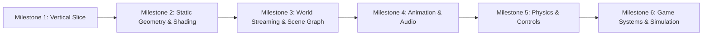

# Reconstruction Roadmap & Milestones

This roadmap defines the iterative development stages from initial technical slice to the full browser game simulation.

---

---

## Milestone 1: The Initial Vertical Slice (Completed)
**Goal:** Prove end-to-end viability by rendering a real, locally owned asset from the game archives in a modern browser canvas.
- [x] Read-only BIG/BIX parser with bounds checks and automated tests.
- [x] Extraction of candidate asset from `UI.big` or `PrefabData.big`.
- [x] Browser shell (Vite + WebGPU / WebGL2 canvas).
- [x] Render 3D / 2D resource with orbit camera and technical metadata inspector.

## Milestone 2: Static Geometry, Textures & Shading (Completed)
**Goal:** Render complete static props, building meshes, and multi-layer materials.
- [x] Geometry decoder (vertex buffers, normals, UVs, index buffers) via `Illusion::BufferLoader` reverse engineering.
- [x] Texture decoding (BC1/BC2/BC3/BC5 block decompression and WebGL2 texture binding) via `Illusion::rTexture`.
- [x] Shader pipeline matching D3D11 lighting and material uniforms.
- [x] Live interactive browser client running with model/texture switcher and real-time HUD.

## Milestone 3: World Streaming & Scene Graph
**Goal:** Load Hong Kong street sections with spatial hierarchy.
- [ ] Parse world placement grids and transformation matrices.
- [ ] Asynchronous chunk streaming based on camera frustum and distance.
- [ ] LRU caching in IndexedDB for streamed blocks.

## Milestone 4: Animation, Characters & Audio
**Goal:** Animated character models and environmental sound.
- [ ] Bone hierarchy, skeleton bind poses, and skin weights.
- [ ] Decompress Wwise `.pck` audio chunks using Web Audio API.

## Milestone 5: Physics, Collision & Camera
**Goal:** Controllable character moving through colliding physical geometry.
- [ ] Collision mesh parsing and integration with physics engine (e.g. Rapier / WebAssembly PhysX).
- [ ] Third-person camera controller and keyboard/gamepad input abstraction.

## Milestone 6: Gameplay, NPCs, Vehicles & Missions
**Goal:** Simulating interactive open-world systems.
- [ ] Vehicle physics and traffic navigation.
- [ ] Melee combat state machine.
- [ ] Script and mission triggers.

