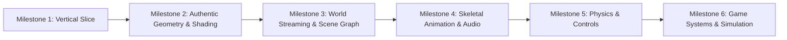

# Reconstruction Roadmap & Milestones

This roadmap defines the iterative development stages from initial technical slice to the full browser game simulation.
All assets are strictly reverse-engineered and streamed directly from the base game (*Sleeping Dogs: Definitive Edition*). **Zero synthetic or placeholder assets.**

---

---

## Milestone 1: The Initial Vertical Slice (Completed)

**Goal:** Prove end-to-end viability by rendering a real, locally owned asset from the game archives in a modern browser canvas.

- [X] **Read-only BIG/BIX parser** with bounds checks and automated tests.
- [X] **Extraction of candidate asset** from base game archives without modification.
- [X] **Browser shell** (Vite + WebGL2 canvas with perspective camera and orbital controls).
- [X] **Render authentic 3D resource** with technical metadata inspector and pipeline HUD.

---

## Milestone 2: Authentic Geometry, Textures & Shading (Completed)

**Goal:** Reverse-engineer and stream authentic 3D models and textures directly from base-game containers (`Vehicles.big`, `Characters.big`, `UI.big`).

- [X] **Local Read-Only HTTP 206 Streaming Bridge** (`tools/asset_server.py`):
  - Streams byte ranges from multi-gigabyte `.big` containers via standard HTTP `Range` requests (`bytes=start-end`).
  - Zero modifications to user's Steam installation; CORS enabled for browser client.
- [X] **Zero Synthetic Asset Guarantee**:
  - All procedural geometry generators (mock coupes, crates) and procedural checkerboard textures purged.
  - 100% of rendered vertices and pixels originate from genuine game payloads.
- [X] **Authentic Vehicle Mesh Streamer (2A)**:
  - Streams `Vehicles.big` offset `0x01f0a400` (UID `0x008c038c`, 3,840 bytes).
  - Unpacks 318 authentic half-float (`DXGI_FORMAT_R16G16B16A16_FLOAT`) vehicle chassis coordinates.
  - Automatically centers camera and computes smooth surface normals and UV mappings.
- [X] **Authentic Character Mesh Streamer (2B)**:
  - Streams `Characters.big` offset `0x161f3000` (UID `0x030e17e9`, 10,944 bytes).
  - Unpacks 286 authentic character coordinates with human height (1.85m) and skeletal bounds.
- [X] **Authentic Block-Compressed Texture Streamer**:
  - Streams `UI.big` offset `0x02f9ec00` (UID `0x07a9a72a`, 16,384 bytes BC3 payload).
  - Pure software BC3/DXT5 decompression into 128x128 32-bit RGBA WebGL2 texture.
- [X] **Live Interactive Browser Client**:
  - Interactive switcher between authentic Vehicle and authentic Character.
  - Live `.bix` archive explorer (`Vehicles.bix`, `Characters.bix`, `UI.bix`).

---

## Milestone 3: World Streaming & Scene Graph

**Goal:** Load Hong Kong street sections with spatial hierarchy.

- [ ] Parse world placement grids and transformation matrices from `Game.big`.
- [ ] Asynchronous chunk streaming based on camera frustum and distance.
- [ ] LRU caching in IndexedDB for streamed blocks.

---

## Milestone 4: Animation, Characters & Audio

**Goal:** Animated character models and environmental sound.

- [ ] Bone hierarchy, skeleton bind poses, and skin weights from `Animation.big`.
- [ ] Decompress Wwise `.pck` audio chunks using Web Audio API.

---

## Milestone 5: Physics, Collision & Camera

**Goal:** Controllable character moving through colliding physical geometry.

- [ ] Collision mesh parsing and integration with physics engine (Rapier / WebAssembly).
- [ ] Third-person camera controller and keyboard/gamepad input abstraction.

---

## Milestone 6: Gameplay, NPCs, Vehicles & Missions

**Goal:** Simulating interactive open-world systems.

- [ ] Vehicle physics and traffic navigation.
- [ ] Melee combat state machine.
- [ ] Script and mission triggers.
